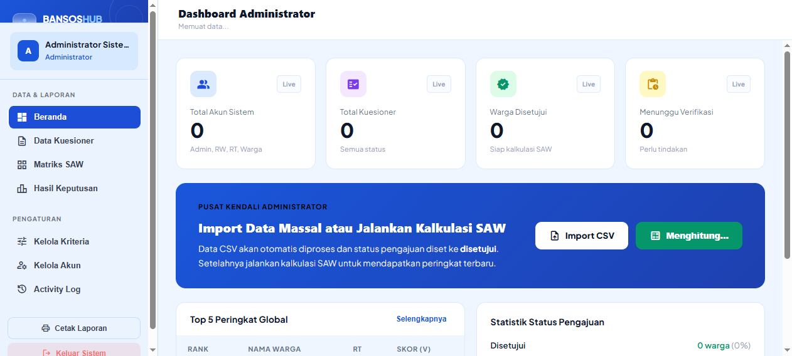
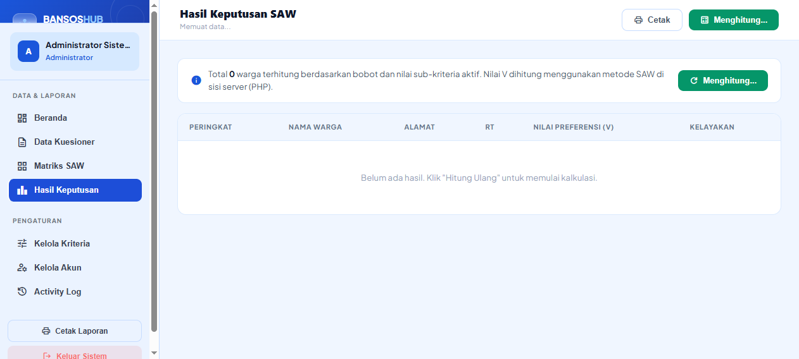
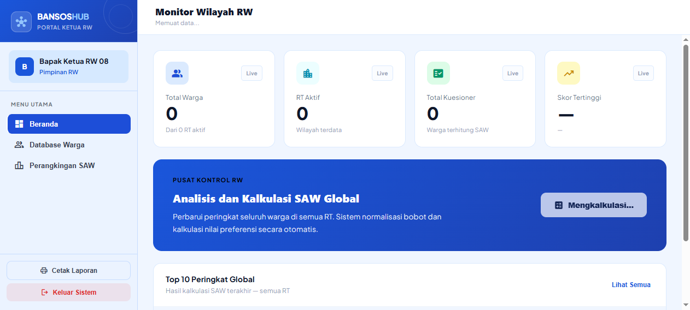
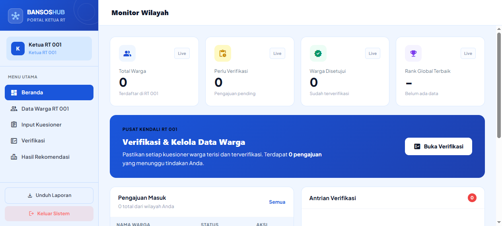
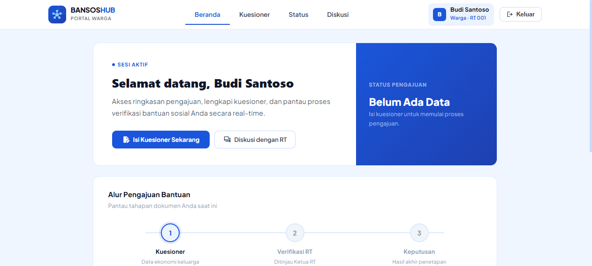

# BansosHub — Sistem Pendukung Keputusan Bantuan Sosial (Metode SAW)

[](LICENSE)
[](https://laravel.com)
[](https://react.dev)
[](#pengujian-dan-quality-gates)
[](#pengujian-dan-quality-gates)

> Platform pengambilan keputusan berbasis web untuk menentukan prioritas penerima bantuan sosial secara transparan, akuntabel, dan objektif menggunakan algoritma **Simple Additive Weighting (SAW)**, dengan alur kerja hierarki multi-peran (**Administrator**, **Ketua RW**, **Ketua RT**, dan **Warga**).

---

## Ringkasan Proyek & Masalah yang Diselesaikan

Penyaluran bantuan sosial di tingkat kewilayahan sering menghadapi kendala verifikasi manual, subjektivitas penilaian, dan minimnya transparansi kepada warga. **BansosHub** menghadirkan solusi digital menyeluruh:
1. **Obyektivitas Matematis**: Mengeliminasi bias subjektif melalui kalkulasi matriks normalisasi SAW dengan 10 kriteria terukur (kombinasi atribut *benefit* dan *cost*).
2. **Hierarki Tata Kelola Wilayah**: Alur bertingkat di mana RT memverifikasi kuesioner faktual, RW mengawasi peringkat makro wilayah, dan Administrator mengelola dataset dan bobot kriteria.
3. **Transparansi Warga**: Warga dapat mendaftar mandiri, memantau status pengajuan secara real-time, dan berkomunikasi langsung dengan petugas RT melalui fitur konsultasi chat interaktif.

---

## Pratinjau Antarmuka (UI Previews)

| Administrator Dashboard | Peringkat SAW Global |
| :---: | :---: |
|  |  |
| *Ringkasan matriks nilai & manajemen user* | *Hasil perankingan alternatif SAW (V)* |

| Monitoring Ketua RW | Verifikasi Lapangan RT | Portal Pengajuan Warga |
| :---: | :---: | :---: |
|  |  |  |
| *Pengawasan lintas RT & distribusi bansos* | *Validasi kuesioner & chat konsultasi* | *Pengisian formulir & pelacakan status* |

> *Catatan: Letakkan tangkapan layar antarmuka pada folder `docs/screenshots/`.*

---

## Fitur Utama Berdasarkan Peran

### 1. Administrator Sistem (Super Admin)
- **Manajemen Pengguna Lengkap**: CRUD akun untuk seluruh peran (Admin, RW, RT, Warga) dengan isolasi nomor RT.
- **Kalibrasi Kriteria & Bobot**: Penyesuaian nama, tipe (*benefit* / *cost*), dan bobot kriteria secara dinamis.
- **Import Data Massal**: Pengunggahan kuesioner warga via file CSV dengan validasi header, pelaporan per baris, dan status hasil **selalu `menunggu`** — bukan disetujui otomatis. Satu baris gagal membatalkan seluruh impor (atomik).
- **Audit Logging**: Pencatatan aktivitas sistem penting (perubahan status, kalkulasi ranking) ke tabel `activity_logs`.
- **Utilitas Perbaikan Data**: `/api/admin/fix-data` berjalan **dry-run** secara default; perubahan hanya terjadi dengan `mode=apply` eksplisit.

### 2. Ketua RW
- **Monitoring Makro Wilayah**: Pemantauan agregat data warga dan pengajuan dari seluruh RT di bawah lingkup RW.
- **Kalkulasi & Analisis SAW**: Eksekusi perankingan global dengan visualisasi skor preferensi tertinggi hingga terendah.
- **Ekspor Laporan**: Unduh laporan perankingan sebagai berkas CSV/TSV dari server (`GET /api/saw/report/export`), dengan nilai dan cakupan yang identik dengan yang tampil di layar.
- **Pengawasan Pengaduan**: Melihat pengaduan dari seluruh RT dan mengambil alih penanganan bila RT tidak tersedia.

### 3. Ketua RT
- **Verifikasi Lapangan Faktual**: Meninjau jawaban kuesioner warga di RT-nya sebelum disetujui atau ditolak.
- **Otomatisasi Penilaian**: Persetujuan pengajuan otomatis meng-generate rekam matriks penilaian kriteria.
- **Rekomendasi Terbatas Wilayah**: Hasil SAW hanya berisi warga RT-nya sendiri, dengan peringkat mulai dari 1 (`ranking_rt`) — bukan peringkat global RW.
- **Penanganan Pengaduan**: Menerima/menolak keluhan warga wilayahnya beserta tanggapan; pengaduan RT lain tidak terlihat.
- **Pendaftaran Warga Terpimpin**: Mendaftarkan warga yang memiliki keterbatasan akses teknologi.
- **Ruang Diskusi (Chat)**: Komunikasi dua arah langsung dengan warga per pengajuan untuk klarifikasi berkas.

### 4. Warga
- **Registrasi & Login Mandiri**: Pembuatan akun warga terverifikasi nomor RT domisili.
- **Kuesioner Terstandar**: Pengisian 10 butir pertanyaan sosio-ekonomi dengan indikator progres visual.
- **Pelacakan Status Real-time**: Indikator status (Menunggu Verifikasi, Disetujui, Ditolak) secara transparan.
- **Pengaduan**: Mengirim keluhan (kategori umum/data/verifikasi/pencairan/lainnya), melihat status & riwayat penanganannya — hanya milik sendiri.
- **Konsultasi Interaktif**: Mengirim dan menerima pesan tanggapan dari Ketua RT.

> **Pengaduan lintas peran:** warga membuat → RT wilayahnya menindaklanjuti (terima/tolak + tanggapan) → RW & admin melihat seluruh RT dan dapat mengambil alih. Setiap perubahan status tercatat di `pengaduan_riwayat`.

---

## Logika & Formulasi Algoritma SAW

Algoritma Simple Additive Weighting menormalisasi matriks keputusan $X$ menjadi matriks ternormalisasi $R$:

1. **Kriteria Benefit** (Semakin tinggi semakin layak):
   $$r_{ij} = \frac{x_{ij}}{\max_i(x_{ij})}$$
2. **Kriteria Cost** (Semakin rendah semakin layak — misal pengeluaran & daya listrik):
   $$r_{ij} = \frac{\min_i(x_{ij})}{x_{ij}}$$
3. **Nilai Preferensi Alternatif ($V_i$)**:
   $$V_i = \sum_{j=1}^{n} w_j \cdot r_{ij}$$

Keluaran $V_i$ tertinggi menunjukkan warga dengan prioritas bantuan sosial paling mendesak.

**Catatan implementasi (2026-11):** perhitungan dipusatkan di `App\Services\SawCalculator`
sehingga `/saw/hitung`, `/saw/dataset`, dan `/saw/report/export` memakai satu definisi
eligibilitas dan satu snapshot transaksi. Alternatif yang tidak eligible (warga tidak
ditemukan, nama kosong, matriks belum lengkap) **tidak dibuang diam-diam** — semuanya
dikembalikan di field `dilewati` dan ditampilkan sebagai banner di ketiga dashboard staf.
Kriteria yang nilainya konstan di seluruh alternatif dilaporkan di
`kriteria_tanpa_variasi` karena kontribusinya ke peringkat nol.

---

## Tech Stack

- **Backend**: PHP 8.2+, Laravel 12 (REST API, Eloquent ORM, Laravel Sanctum token auth)
- **Frontend**: React 19, Vite 8, Tailwind CSS, Lucide React / Material Symbols
- **Database**: SQLite (Development & Testing) / MySQL & MariaDB (Production)
- **Code Quality**: Laravel Pint (PSR-12), ESLint 9+ Flat Config, Prettier
- **CI / CD**: GitHub Actions Automated Pipeline

---

## Panduan Instalasi & Menjalankan Aplikasi

### Kebutuhan Sistem
- PHP >= 8.2 (ekstensi `pdo_sqlite`, `mbstring`, `openssl`)
- Composer >= 2.x
- Node.js >= 20.x & npm >= 10.x

### Langkah 1: Kloning Repositori
```bash
git clone https://github.com/WildanHumaidi/proyek_bansos.git
cd proyek_bansos
```

### Langkah 2: Setup Backend (Laravel 12 API)
```bash
cd bansos-backend
cp .env.example .env
composer install
php artisan key:generate
php artisan migrate --seed
php artisan serve
```
Backend API aktif di `http://127.0.0.1:8000`.

### Langkah 3: Setup Frontend (React 19 SPA)
Buka terminal baru di folder proyek:
```bash
cd bansos-frontend
cp .env.example .env
npm install
npm run dev
```
Frontend aplikasi aktif di `http://localhost:5173`.

---

## Akun Pengujian Default (Seeded Accounts)

Database seeder menyediakan akun bawaan untuk tiap hak akses:

| Peran | Username | Password | Keterangan |
|---|---|---|---|
| **Administrator** | `admin` | `admin123` | Akses penuh manajemen sistem & kriteria |
| **Ketua RW** | `rw08` | `rw123` | Pengawasan makro wilayah & SPK global |
| **Ketua RT 001** | `rt001` | `rt123` | Verifikasi warga wilayah RT 001 |
| **Ketua RT 002** | `rt002` | `rt123` | Verifikasi warga wilayah RT 002 |
| **Warga** | `warga01` | `warga123` | Simulasi pengajuan dan status warga |

> **Catatan:** akun `warga01` hanya dibuat oleh `UserSeeder` (lingkungan demo/uji).
> Seeder ini **idempoten** — dijalankan berulang tidak menggandakan akun — dan
> **tidak boleh dijalankan di production**: password demo di tabel atas hanya untuk
> pengembangan lokal. Pada database produksi yang diisi lewat import CSV, akun warga
> dibuat dari data warga nyata dan ditautkan lewat kolom `users.id_warga` — bukan
> dicocokkan berdasarkan nama. Akun yang belum tertaut akan ditolak (409) saat
> mengajukan; admin dapat menautkannya lewat `PUT /api/admin/users/{id}/taut-warga`.

---

## Pengujian dan Quality Gates

Seluruh fungsionalitas dan konsistensi kode dijamin oleh rangkaian pengujian otomatis dan linter:

```bash
# Backend Automated Tests (136 tests, 3031 assertions)
cd bansos-backend
php artisan test

# Backend Linting (Laravel Pint)
composer lint
composer format

# Frontend Linting & Build (ESLint & Vite)
cd ../bansos-frontend
npm run lint
npm run format
npm run build
```

### Dependency audit

```bash
cd bansos-backend && composer audit     # 0 advisory (2026-11-25)
cd ../bansos-frontend && npm audit      # 0 vulnerabilities (2026-11-25)
```

Kedua audit bersih per 2026-11-25. Sebelumnya: 53 advisory backend (1 critical —
TokenGuard auth bypass, 15 high) dan 17 advisory frontend (12 high, termasuk axios
& react-router-dom). Rincian di `FIX_IMPLEMENTATION_REPORT.md` §8a.

### Regression gate per tingkat keparahan

| Berkas | Cakupan |
|---|---|
| `tests/Feature/P0RemediationTest.php` | 10 test — CSV asli → mapper → penilaian → `menunggu` → approval → SAW → ranking API |
| `tests/Feature/P1RemediationTest.php` | 10 test — identitas warga, validasi jawaban, rollback approval, header CSV, resubmission |
| `tests/Feature/P2RemediationTest.php` | 3 test — export laporan, kesamaan eligibility dataset↔ranking, snapshot transaksi |
| `tests/Feature/PengaduanTest.php` | 11 test — pengaduan warga/RT/RW/admin: isolasi wilayah, status valid, riwayat, akun tanpa identitas |
| `tests/Unit/RtFormatterTest.php` | 6 test — kontrak kanonikalisasi RT (`formatRt`, `intValue`, `sama`, rule validasi termasuk penolakan RT 0) |
| `tests/Feature/JurnalKelompokTest.php` | 26 test — delapan kelompok pengujian jurnal (autentikasi, registrasi, kuesioner, verifikasi RT, SAW + matriks, import CSV, manajemen akun, cetak laporan) |
| `tests/Feature/P3HygieneTest.php` | 8 test — kolom `warga.password` dihapus, status baca chat (isolasi lintas pengguna), rate limit `saw` & `chat` |
| `tests/Feature/ChatPollingTest.php` | 4 test — `GET` tidak menandai terbaca, urutan pesan deterministik, pesan baru terlihat pada polling berikutnya, isolasi lintas warga |

### UAT guard (UI mobile)

Dua belas skrip Playwright di `docs/uat/` menjaga overflow 360px, sidebar off-canvas,
kontras WCAG (Beranda, halaman ranking, panel pengaduan), font race, isolasi data
pengaduan antar RT, format label RT yang konsisten, status baca chat, polling
percakapan (warga & RT), tidak adanya ketergantungan Tailwind CDN, dan font yang
di-host sendiri (tanpa permintaan ke Google Fonts). Cara menjalankan: lihat
`docs/uat/README.md`.

---

## Struktur Repositori

```
proyek_bansos/
├── .github/
│   └── workflows/
│       └── ci.yml             # GitHub Actions CI workflow (lint & test)
├── bansos-backend/             # RESTful API Backend
│   ├── app/
│   │   ├── Http/Controllers/Api/ # API Controllers (Auth, SAW, RT, Warga, Chat, Pengaduan)
│   │   ├── Http/Middleware/      # Role-based Guard Middleware
│   │   ├── Services/             # SSOT: RtFormatter, JawabanMapper, CsvImporter, SawCalculator
│   │   └── Models/               # Model Eloquent & Relasi
│   ├── config/cors.php           # Konfigurasi CORS berbasis env
│   ├── database/
│   │   ├── migrations/           # Skema tabel database
│   │   └── seeders/              # Seeder user, kriteria C1-C10, dan data awal
│   ├── routes/api.php            # Endpoint API REST
│   ├── tests/                    # Feature & Unit test suites
│   ├── .env.example              # Konfigurasi environment backend
│   └── composer.json
│
├── bansos-frontend/            # Frontend SPA (React 19 + Vite)
│   ├── src/
│   │   ├── pages/                # AdminDashboard, RtDashboard, RwDashboard, WargaDashboard
│   │   ├── components/           # RankingWarnings (banner dilewati/kriteria konstan/error)
│   │   ├── services/             # api.js (Axios client & auth)
│   │   ├── lib/                  # report.js (unduh laporan), api.js (re-export)
│   │   ├── App.jsx               # Client router & protected routes
│   │   └── main.jsx
│   ├── .env.example              # Konfigurasi environment frontend
│   ├── eslint.config.js          # ESLint 9 configuration
│   └── package.json
│
├── docs/
│   ├── screenshots/              # Folder penampung tangkapan layar antarmuka
│   ├── uat/                      # Skrip guard UI mobile (Playwright)
│   ├── AUDIT.md                  # Laporan audit arsitektur & keamanan
│   ├── PRD.md                    # Dokumen spesifikasi kebutuhan produk
│   └── SAW_JOURNAL_RECONCILIATION.md  # Rekonsiliasi matriks sistem vs jurnal
├── FIX_IMPLEMENTATION_REPORT.md  # Hasil remediasi re-audit 2026-11 + daftar terbuka
├── RE_AUDIT_BANSOS_HUB_REPORT.md # Laporan re-audit jurnal-grounded
├── CONTRIBUTING.md             # Panduan kontribusi tim
├── LICENSE                     # Lisensi MIT
└── README.md                   # Dokumentasi utama proyek
```

---

## Rencana Pengembangan (Roadmap)

- [x] Implementasi Algoritma SAW 10 Kriteria (Benefit & Cost).
- [x] Autentikasi berbasis Sanctum token & otorisasi multi-peran (Admin, RW, RT, Warga).
- [x] Fitur verifikasi RT dua arah dan chat interaktif warga.
- [x] Import dataset kuesioner warga massal via CSV.
- [x] Audit keamanan, penghapusan token dump, penanganan rate limiting, dan IDOR prevention.
- [x] Setup CI Pipeline otomatis (GitHub Actions) dan linting Pint + ESLint.
- [x] Remediasi re-audit 2026-11: mapper CSV tanpa fallback (900/900 sel benar),
      impor berstatus `menunggu`, scope ranking per RT + `ranking_rt` server-side,
      banner `dilewati`, export laporan CSV server-side, sub-sistem pengaduan.
      Rincian & bukti: `FIX_IMPLEMENTATION_REPORT.md`.
- [ ] Ekspor laporan ke format Excel XLSX native untuk kebutuhan arsip kelurahan.
- [ ] Notifikasi status pengajuan via WhatsApp Gateway / Email.
- [ ] Modul penentuan kuota dinamis penerima bansos per RT berdasarkan pagu anggaran.

---

## Lisensi

Proyek ini dilisensikan di bawah [MIT License](LICENSE) — bebas digunakan dan dikembangkan untuk keperluan riset dan portofolio.
