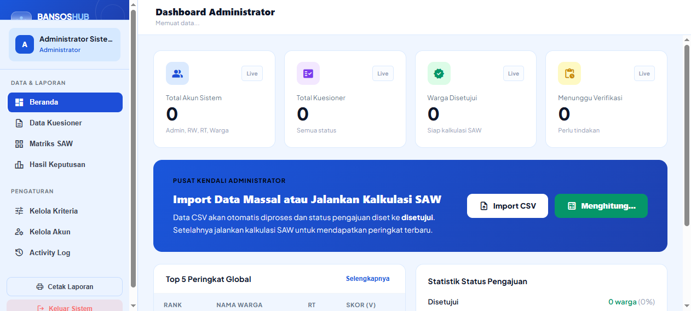
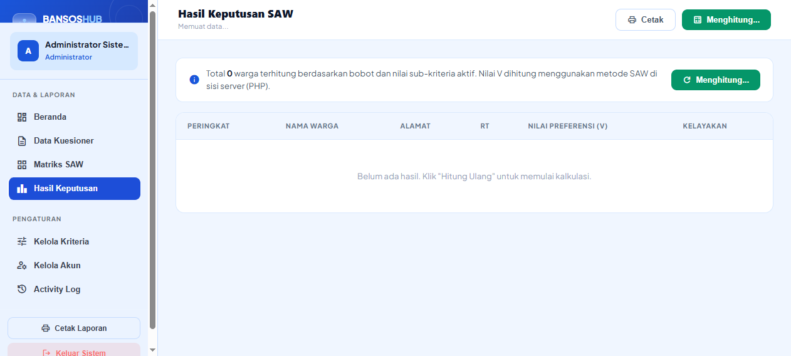
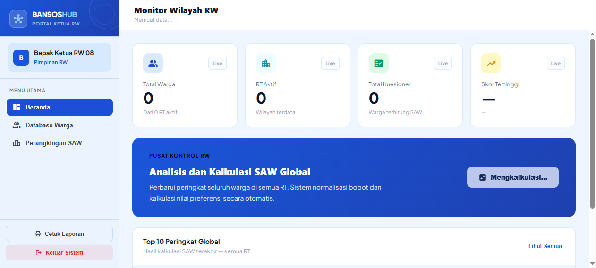
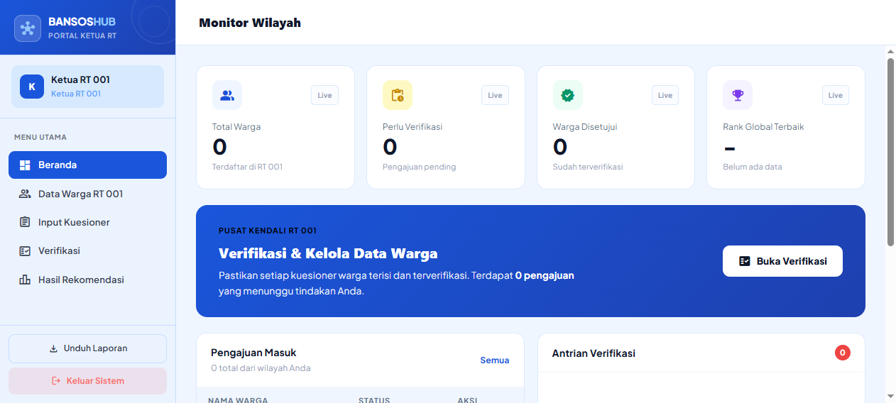
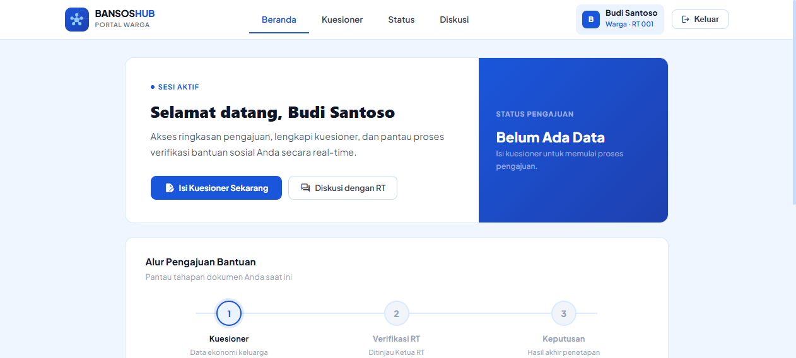

# BansosHub — Sistem Pendukung Keputusan Bantuan Sosial (Metode SAW)

[](LICENSE)
[](https://laravel.com)
[](https://react.dev)
[](#pengujian-dan-quality-gates)
[](#pengujian-dan-quality-gates)

> Platform pengambilan keputusan berbasis web untuk menentukan prioritas penerima bantuan sosial secara transparan, akuntabel, dan objektif menggunakan algoritma **Simple Additive Weighting (SAW)**, dengan alur kerja hierarki multi-peran (**Administrator**, **Ketua RW**, **Ketua RT**, dan **Warga**).

---

## Ringkasan Proyek & Masalah yang Diselesaikan

Penyaluran bantuan sosial di tingkat kewilayahan sering menghadapi kendala verifikasi manual, subjektivitas penilaian, dan minimnya transparansi kepada warga. **BansosHub** menghadirkan solusi digital menyeluruh:
1. **Obyektivitas Matematis**: Mengeliminasi bias subjektif melalui kalkulasi matriks normalisasi SAW dengan 10 kriteria terukur (kombinasi atribut *benefit* dan *cost*).
2. **Hierarki Tata Kelola Wilayah**: Alur bertingkat di mana RT memverifikasi kuesioner faktual, RW mengawasi peringkat makro wilayah, dan Administrator mengelola dataset dan bobot kriteria.
3. **Transparansi Warga**: Warga dapat mendaftar mandiri, memantau status pengajuan secara real-time, dan berkomunikasi langsung dengan petugas RT melalui fitur konsultasi chat interaktif.

---

## Pratinjau Antarmuka (UI Previews)

| Administrator Dashboard | Peringkat SAW Global |
| :---: | :---: |
|  |  |
| *Ringkasan matriks nilai & manajemen user* | *Hasil perankingan alternatif SAW (V)* |

| Monitoring Ketua RW | Verifikasi Lapangan RT | Portal Pengajuan Warga |
| :---: | :---: | :---: |
|  |  |  |
| *Pengawasan lintas RT & distribusi bansos* | *Validasi kuesioner & chat konsultasi* | *Pengisian formulir & pelacakan status* |

> *Catatan: Letakkan tangkapan layar antarmuka pada folder `docs/screenshots/`.*

---

## Fitur Utama Berdasarkan Peran

### 1. Administrator Sistem (Super Admin)
- **Manajemen Pengguna Lengkap**: CRUD akun untuk seluruh peran (Admin, RW, RT, Warga) dengan isolasi nomor RT.
- **Kalibrasi Kriteria & Bobot**: Penyesuaian nama, tipe (*benefit* / *cost*), dan bobot kriteria secara dinamis.
- **Import Data Massal**: Pengunggahan kuesioner warga via file CSV dengan pencocokan otomatis.
- **Audit Logging**: Pencatatan aktivitas sistem penting (perubahan status, kalkulasi ranking) ke tabel `activity_logs`.

### 2. Ketua RW
- **Monitoring Makro Wilayah**: Pemantauan agregat data warga dan pengajuan dari seluruh RT di bawah lingkup RW.
- **Kalkulasi & Analisis SAW**: Eksekusi perankingan global dengan visualisasi skor preferensi tertinggi hingga terendah.
- **Ekspor Dokumen**: Cetak laporan dan rekapitulasi data penerima bantuan dalam format standar cetak.

### 3. Ketua RT
- **Verifikasi Lapangan Faktual**: Meninjau jawaban kuesioner warga di RT-nya sebelum disetujui atau ditolak.
- **Otomatisasi Penilaian**: Persetujuan pengajuan otomatis meng-generate rekam matriks penilaian kriteria.
- **Pendaftaran Warga Terpimpin**: Mendaftarkan warga yang memiliki keterbatasan akses teknologi.
- **Ruang Diskusi (Chat)**: Komunikasi dua arah langsung dengan warga per pengajuan untuk klarifikasi berkas.

### 4. Warga
- **Registrasi & Login Mandiri**: Pembuatan akun warga terverifikasi nomor RT domisili.
- **Kuesioner Terstandar**: Pengisian 10 butir pertanyaan sosio-ekonomi dengan indikator progres visual.
- **Pelacakan Status Real-time**: Indikator status (Menunggu Verifikasi, Disetujui, Ditolak) secara transparan.
- **Konsultasi Interaktif**: Mengirim dan menerima pesan tanggapan dari Ketua RT.

---

## Logika & Formulasi Algoritma SAW

Algoritma Simple Additive Weighting menormalisasi matriks keputusan $X$ menjadi matriks ternormalisasi $R$:

1. **Kriteria Benefit** (Semakin tinggi semakin layak):
   $$r_{ij} = \frac{x_{ij}}{\max_i(x_{ij})}$$
2. **Kriteria Cost** (Semakin rendah semakin layak — misal pengeluaran & daya listrik):
   $$r_{ij} = \frac{\min_i(x_{ij})}{x_{ij}}$$
3. **Nilai Preferensi Alternatif ($V_i$)**:
   $$V_i = \sum_{j=1}^{n} w_j \cdot r_{ij}$$

Keluaran $V_i$ tertinggi menunjukkan warga dengan prioritas bantuan sosial paling mendesak.

---

## Tech Stack

- **Backend**: PHP 8.2+, Laravel 12 (REST API, Eloquent ORM, Laravel Sanctum token auth)
- **Frontend**: React 19, Vite 8, Tailwind CSS, Lucide React / Material Symbols
- **Database**: SQLite (Development & Testing) / MySQL & MariaDB (Production)
- **Code Quality**: Laravel Pint (PSR-12), ESLint 9+ Flat Config, Prettier
- **CI / CD**: GitHub Actions Automated Pipeline

---

## Panduan Instalasi & Menjalankan Aplikasi

### Kebutuhan Sistem
- PHP >= 8.2 (ekstensi `pdo_sqlite`, `mbstring`, `openssl`)
- Composer >= 2.x
- Node.js >= 20.x & npm >= 10.x

### Langkah 1: Kloning Repositori
```bash
git clone https://github.com/WildanHumaidi/proyek_bansos.git
cd proyek_bansos
```

### Langkah 2: Setup Backend (Laravel 12 API)
```bash
cd bansos-backend
cp .env.example .env
composer install
php artisan key:generate
php artisan migrate --seed
php artisan serve
```
Backend API aktif di `http://127.0.0.1:8000`.

### Langkah 3: Setup Frontend (React 19 SPA)
Buka terminal baru di folder proyek:
```bash
cd bansos-frontend
cp .env.example .env
npm install
npm run dev
```
Frontend aplikasi aktif di `http://localhost:5173`.

---

## Akun Pengujian Default (Seeded Accounts)

Database seeder menyediakan akun bawaan untuk tiap hak akses:

| Peran | Username | Password | Keterangan |
|---|---|---|---|
| **Administrator** | `admin` | `admin123` | Akses penuh manajemen sistem & kriteria |
| **Ketua RW** | `rw08` | `rw123` | Pengawasan makro wilayah & SPK global |
| **Ketua RT 001** | `rt001` | `rt123` | Verifikasi warga wilayah RT 001 |
| **Ketua RT 002** | `rt002` | `rt123` | Verifikasi warga wilayah RT 002 |
| **Warga** | `warga01` | `warga123` | Simulasi pengajuan dan status warga |

---

## Pengujian dan Quality Gates

Seluruh fungsionalitas dan konsistensi kode dijamin oleh rangkaian pengujian otomatis dan linter:

```bash
# Backend Automated Tests (19 tests, 48 assertions)
cd bansos-backend
php artisan test

# Backend Linting (Laravel Pint)
composer lint
composer format

# Frontend Linting & Build (ESLint & Vite)
cd ../bansos-frontend
npm run lint
npm run format
npm run build
```

---

## Struktur Repositori

```
proyek_bansos/
├── .github/
│   └── workflows/
│       └── ci.yml             # GitHub Actions CI workflow (lint & test)
├── bansos-backend/             # RESTful API Backend
│   ├── app/
│   │   ├── Http/Controllers/Api/ # API Controllers (Auth, SAW, RT, Warga, Chat)
│   │   ├── Http/Middleware/      # Role-based Guard Middleware
│   │   └── Models/               # Model Eloquent & Relasi
│   ├── config/cors.php           # Konfigurasi CORS berbasis env
│   ├── database/
│   │   ├── migrations/           # Skema tabel database
│   │   └── seeders/              # Seeder user, kriteria C1-C10, dan data awal
│   ├── routes/api.php            # Endpoint API REST
│   ├── tests/                    # Feature & Unit test suites
│   ├── .env.example              # Konfigurasi environment backend
│   └── composer.json
│
├── bansos-frontend/            # Frontend SPA (React 19 + Vite)
│   ├── src/
│   │   ├── pages/                # AdminDashboard, RtDashboard, RwDashboard, WargaDashboard
│   │   ├── services/             # api.js (Axios client & auth) & constants.js
│   │   ├── App.jsx               # Client router & protected routes
│   │   └── main.jsx
│   ├── .env.example              # Konfigurasi environment frontend
│   ├── eslint.config.js          # ESLint 9 configuration
│   └── package.json
│
├── docs/
│   ├── screenshots/              # Folder penampung tangkapan layar antarmuka
│   ├── AUDIT.md                  # Laporan audit arsitektur & keamanan
│   └── PRD.md                    # Dokumen spesifikasi kebutuhan produk
├── CONTRIBUTING.md             # Panduan kontribusi tim
├── LICENSE                     # Lisensi MIT
└── README.md                   # Dokumentasi utama proyek
```

---

## Rencana Pengembangan (Roadmap)

- [x] Implementasi Algoritma SAW 10 Kriteria (Benefit & Cost).
- [x] Autentikasi berbasis Sanctum token & otorisasi multi-peran (Admin, RW, RT, Warga).
- [x] Fitur verifikasi RT dua arah dan chat interaktif warga.
- [x] Import dataset kuesioner warga massal via CSV.
- [x] Audit keamanan, penghapusan token dump, penanganan rate limiting, dan IDOR prevention.
- [x] Setup CI Pipeline otomatis (GitHub Actions) dan linting Pint + ESLint.
- [ ] Ekspor laporan ke format Excel XLSX native untuk kebutuhan arsip kelurahan.
- [ ] Notifikasi status pengajuan via WhatsApp Gateway / Email.
- [ ] Modul penentuan kuota dinamis penerima bansos per RT berdasarkan pagu anggaran.

---

## Lisensi

Proyek ini dilisensikan di bawah [MIT License](LICENSE) — bebas digunakan dan dikembangkan untuk keperluan riset dan portofolio.
